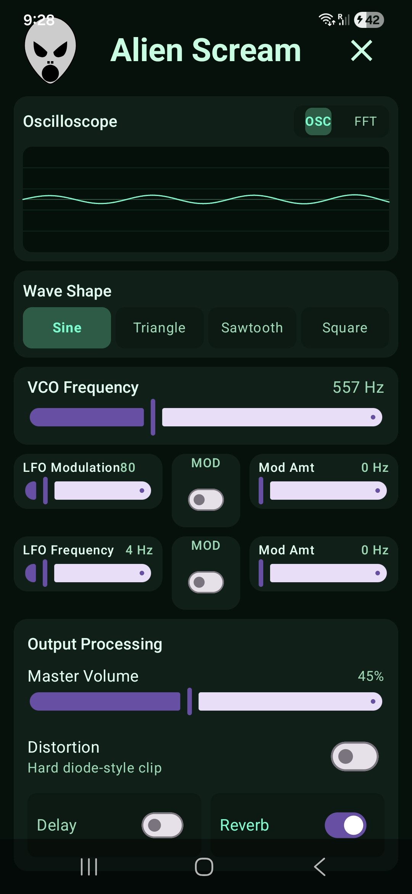

# 👽 Alien Scream

> **Alien Scream** is a powerful single-oscillator synthesizer for Android designed for creating unique sci-fi soundscapes, dynamic sound effects, and experimental synth textures.

---

## 📸 Screenshots & Artwork

  

---
## ✨ Features

- **Oscillator & Waveforms:** Select between standard waveforms including **Sine**, **Triangle**, **Sawtooth**, and **Square** to generate your core sound.
- **Real-Time Visualizers:**
  - **Oscilloscope:** View waveform oscillations live as you tweak parameters.
  - **FFT Spectrum View:** Analyze frequency distribution across the spectrum in real time.
- **Frequency Control:** Precise **VCO Frequency** adjustment slider.
- **LFO Modulation:** Dual Low-Frequency Oscillator (LFO) controls with adjustable frequency and modulation depth switches.
- **Audio Effects & Output Processing:**
  - **Distortion:** Toggleable hard diode-style clipping for intense gritty tone shaping.
  - **Delay:** Built-in delay effect for spacey echo tails.
  - **Reverb:** Ambient reverb processing for deep atmospheric space effects.
  - **Master Volume Control:** Smooth output level control.

 

---

## 📲 Download

Get **Alien Scream** directly on your Android device from the Google Play Store:

👉 **[Download Alien Scream on Google Play](https://play.google.com/store/apps/details?id=com.alienscream.app)**

---

## 📄 License

This repository is maintained for project documentation and source code reference. See `LICENSE` file for full terms.
